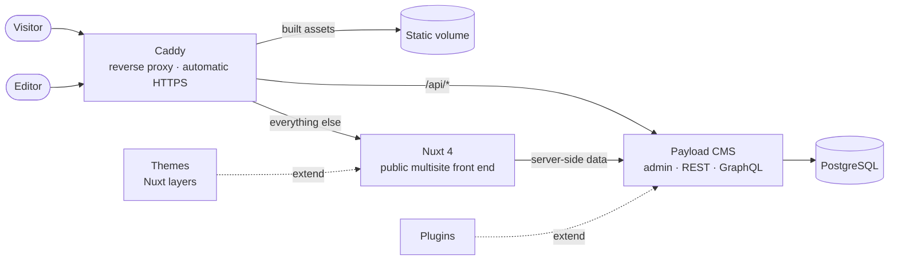

<p align="center">
  <picture>
    <source media="(prefers-color-scheme: dark)" srcset="apps/cms/public/brand/logo-horizontal-reversed.svg">
    
  </picture>
</p>

<h3 align="center">One cockpit for every site you run.</h3>

<p align="center">
  <strong>Polysite</strong> is the multisite CMS for organizations that publish more than one website —
  a static-first platform with a block-based page builder, role-based access you can edit
  from the admin UI, and a plugin and theme system that keeps the core generic.
</p>

<p align="center">
  <a href="LICENSE.md"></a>
  
  
  
  
  
</p>

<p align="center">
  <a href="#quick-start">Quick start</a> ·
  <a href="#features">Features</a> ·
  <a href="#how-it-works">How it works</a> ·
  <a href="#extend-polysite">Plugins &amp; themes</a> ·
  <a href="docs/ARCHITECTURE.md">Architecture</a> ·
  <a href="#license">License</a>
</p>

---

## What is Polysite?

Polysite runs a whole network of public websites — news, informational pages,
campaign and petition sites — from **one editorial back end**. Editors work in
a familiar admin UI and never touch code; each site gets its own domain, theme
and branding; and the public pages stay fast because the front end is
static-first: a page is rendered once, kept in a cache, and rendered again only when an
editor publishes a change.

It is built for teams that today maintain a separate install per site and want
to stop paying that cost, without giving up per-site isolation, branding or
access control.

> **Source-available, not open source.** Polysite is licensed under the
> Polysite Source-Available License (see [License](#license)): free to use,
> modify and self-host for your own organization's sites or for
> non-commercial purposes.

## Features

| | |
| --- | --- |
| **Multisite by design** | Every site resolves by its own domain. Content, media and users are scoped per site, so an editor assigned to Site A cannot see or change Site B. |
| **Roles you edit in the admin** | Dynamic RBAC: a Super Admin creates and reshapes roles (which collections, which operations) in the UI — no code change, no deploy. Fails closed: anything not granted is denied. |
| **Block-based page builder** | Compose pages from typed blocks — hero banners, text, FAQ accordions, feature grids, form embeds, signup forms, leader spotlights, donation tiers, commitment grids — with **Live Preview** at mobile, tablet and desktop widths. |
| **Per-site themes and branding** | Each site picks a theme at runtime; logo, colors, fonts, navigation, footer and social links are edited per site in the admin. |
| **Drafts, history and scheduling** | Save a draft without changing the live page, compare and restore earlier versions, schedule a page to publish or unpublish, and mark a draft ready for review. |
| **Work faster in the admin** | Duplicate or clone a page to another site straight from the list, with a row menu on every page and a link to the live page. |
| **SEO built in** | Meta title, description and social image fields that actually render into the page `<head>`, plus managed 301 redirects and a unified list of every URL a site answers to. |
| **Media pipeline** | Uploads are resized and converted to WebP on the way in. |
| **Forms** | A dynamic form builder: sign-up boxes, petitions and contact forms that submit to a per-site inbox, with server-side validation and built-in spam protection. |
| **Privacy and consent** | Purpose statements and consent checkboxes on forms with a stored consent record, automatic deletion after a retention period, and a per-site register to find, export and erase a person's information. Built around PIPEDA. |
| **Plugins** | Add a capability by adding a folder: news and articles, email delivery, analytics, notifications, sign-in security (single sign-on, two-factor, API keys), several languages per site, visitor search, share buttons, signed webhooks, a WordPress importer. Each plugin keeps its data in its own tables, and removing or switching one off never deletes what its users created. Plugins are optional and live in their own repository. |
| **Simple to operate** | One VM, Docker Compose, Caddy with automatic HTTPS, versioned images, a safe deploy script with automatic rollback. No Kubernetes required. |
| **Security checks** | On an https install, placeholder secrets stop the CMS from starting and the first administrator needs a setup token. Sign-in and password-reset requests are limited per address, uploads and request bodies are capped, and the local database port is bound to loopback. See [Securing an install](docs/guide/security.md). |
| **Backed up** | A nightly database and media backup with retention, optional encryption and an off-site copy, and a weekly job that proves the latest one restores. |
| **Observable** | Optional OpenTelemetry tracing; lint and unit tests enforced in CI and by a pre-commit hook. |

## Quick start

**You need**

- **Docker** with Compose v2 (Docker Desktop on Windows and macOS; Docker Engine with the Compose plugin on Linux) and **Git**.
  Nothing else is installed on your machine: all Node.js work happens in containers.
- About **5 GB of free disk** for the images and a few GB of memory for Docker.
  Tested versions (Node 24, PostgreSQL 16, Redis 7, Compose v2, browsers) are in [Requirements](docs/guide/requirements.md).
- Polysite sends **no telemetry** (the images switch off the Next.js and Nuxt usage reporting, and the admin and error pages load nothing from other sites).
  See [Requirements](docs/guide/requirements.md#telemetry).
- These **ports free** on your machine: **80** and **443** (the proxy), **3000** (the site) and **3001** (the CMS), both used by
  the dev loop only, and **5432** (Postgres, reachable from this machine only). If one is taken, move it in `.env`, see
  [If a port is taken](#if-a-port-is-taken).

```bash
git clone https://github.com/polysites/polysite.git
cd polysite
cp .env.example .env
docker compose -f docker-compose.yml -f docker-compose.dev.yml up -d --build
```

`.env.example` is already set up for a local try-out: the wildcard `SITE_DOMAIN=*.localhost` serves every
`<name>.localhost` site and the admin is at `polysite.localhost` (browsers resolve `*.localhost` on their own). The stack is
usable about half a minute after `up` returns; the very first page you open takes several seconds more, because the dev server
compiles it on demand.

**How long it takes.** Measured on the maintainers' Windows 11 machine with Docker Desktop and a fast connection, from `up` to a
demo page showing: **about 110 seconds** the first time (no cached layers: both images built from scratch, packages downloaded;
the base images were already pulled) and **about 45 seconds** with cached layers. A slower connection spends the difference on
downloading packages.

Polysite runs on its own. **Themes and plugins are separate repositories** (`polysite-themes`, `polysite-plugins`) and are
optional: without them you get the core's own neutral theme and no plugins. To add them, clone each **next to** this repository
(each is just a folder, no configuration), say where they are in `.env`, and start with the workspace file added:

```bash
cd ..
git clone https://github.com/polysites/polysite-themes.git
git clone https://github.com/polysites/polysite-plugins.git
cd polysite
# in .env: POLYSITE_THEMES_DIR=../polysite-themes   POLYSITE_PLUGINS_DIR=../polysite-plugins
docker compose -f docker-compose.yml -f docker-compose.dev.yml -f docker-compose.workspace.yml up -d --build
```

(Cloning them into `themes/` and `plugins/` inside this folder still works, with no `.env` change and without the workspace file.)

On an empty database, opening <http://polysite.localhost/admin> shows a **setup page**:
create the administrator account (it becomes the Super Admin) and name your first site,
and you're signed in. (On a server reached over https the page also asks for the
`POLYSITE_SETUP_TOKEN` from `.env`; see [Securing an install](docs/guide/security.md).)
To explore with demo content instead, load the fictional demo
sites, pages and **dev-only** accounts (the script prints the logins; never use them
outside local development, or on a database you have already set up, which it refuses):

```bash
docker compose exec cms npx payload run scripts/seedDevData.ts
```

The demo uses the starter theme when the themes repository is cloned and the core's own theme when it is not (`SEED_THEME=<name>`
picks another, as in `docker compose exec -e SEED_THEME=starter cms ...`). It is safe to run again: a finished seed says so and changes nothing, and one that stopped half way is completed.
To start over, `docker compose down -v` deletes the stack's data.

| What | Where |
| --- | --- |
| Public site | <http://voidslate.localhost> |
| Admin (CMS) | <http://polysite.localhost/admin> |

Use the admin through `http://polysite.localhost` (the Caddy address), not the
direct container port: the CMS builds its URLs from `CMS_DOMAIN`, and a login
made on a different origin won't carry over.

### If a port is taken

Set the host ports in `.env` (all optional, defaults in brackets): `POLYSITE_HTTP_PORT` (80), `POLYSITE_HTTPS_PORT` (443),
`POLYSITE_WEB_PORT` (3000), `POLYSITE_CMS_PORT` (3001) and `POLYSITE_DB_PORT` (5432). If you move the proxy off port 80, put the
same port in the two domains, because the CMS builds its links from them:

```bash
POLYSITE_HTTP_PORT=8080
SITE_DOMAIN=*.localhost:8080
CMS_DOMAIN=polysite.localhost:8080
```

and use <http://voidslate.localhost:8080> and <http://polysite.localhost:8080/admin>. To run a second copy next to another
Polysite stack, also set `COMPOSE_PROJECT_NAME=polysite2` in its `.env`, or the two share containers and volumes.

Want a production-like check instead (real build, real migration)?

```bash
docker compose up --build
```

## How it works



- **Nuxt** renders every public site. Which theme and branding a request gets
  is runtime data (`Site.theme`), not a build-time choice. A rendered page is
  cached and rendered again only after an editor publishes.
- **Payload** is the editorial cockpit and the API. Multi-tenancy, RBAC, the
  page builder, media, SEO and forms all live here.
- **Caddy** terminates TLS and routes by hostname. It serves Nuxt's built assets
  (scripts, styles, fonts) directly from a shared volume, sends the security
  headers and caps request sizes for the CMS, and proxies everything else.
- **PostgreSQL** (Cloud SQL in production) is the single source of truth.

The full picture — request flows, the data model, and a numbered list of every
real bug hit while building it and how it was fixed — is in
[docs/ARCHITECTURE.md](docs/ARCHITECTURE.md).

## Extend Polysite

The core stays generic. Everything specific to a client or a capability lives
in its own repository and is discovered automatically when you drop it in.

| | Repository | What it is |
| --- | --- | --- |
| **Plugins** | [`polysite-plugins`](https://github.com/polysites/polysite-plugins) | Optional capabilities and content types; that repository's README lists what is available. Add a folder, restart the CMS — no config edit. |
| **Themes** | [`polysite-themes`](https://github.com/polysites/polysite-themes) | The starter theme and the developer guide. Presentation layers (Nuxt layers) selected per site: the layout and every page block. Copy the starter to make your own; themes can inherit blocks from a parent. |
| **Deployment** | [`polysite-deploy`](https://github.com/polysites/polysite-deploy) | Kubernetes (Helm chart), your own proxy (nginx, Apache, Traefik), a single VM (cloud-init, Terraform), bare metal, and ready-to-copy Compose setups. |

Each is a separate repository, cloned next to this one. See the plugins repository's README for the plugin contract.

## Project layout

```text
apps/
  web/        Nuxt 4 — the public, multisite front end
  cms/        Payload 3 on Next.js — admin, API, access control
backup/       the backup tool (the polysite-backup image) and the backup policy
deploy/       deploy.sh: the reference deployment (backup, migrations, health-gated switch, rollback)
tests/        smoke, end-to-end, backup and deploy-script tests (tests/README.md)
docs/         guides, architecture and brand guide (builds into a VitePress site)
docker-compose.yml           production-parity stack
docker-compose.dev.yml       fast local loop (hot reload, schema auto-push)
docker-compose.prod.yml      production (published images, Cloud SQL, real domains)
docker-compose.workspace.yml adds the sibling polysite-themes and polysite-plugins to an image build
Caddyfile                    reverse proxy and TLS, shared by every compose file
```

## Documentation

| Doc | Read it for |
| --- | --- |
| [Guides](docs/guide/getting-started.md) | Getting started, what Polysite does, configuration, securing an install, themes, plugins, publishing, languages, forms, privacy, backups, releasing and deploying |
| [Architecture](docs/ARCHITECTURE.md) | How it is built, verified behaviour, known issues and fixes |
| [Brand guide](docs/BRAND.md) | The Polysite mark, colors and type |

The docs also build into a browsable site (VitePress, sources in
`docs/`). To preview it locally, with no Node on your machine:

```bash
docker run --rm -p 4173:4173 -v "$(pwd)/docs:/work" -w /work -e DOCS_BASE=/ node:22 \
  sh -c "npm ci && npx vitepress dev --host 0.0.0.0 --port 4173"
```

Working in the repo day to day? [`CONTRIBUTING.md`](CONTRIBUTING.md) has the command
reference (fast loop, production-parity check, migrations, import-map
regeneration).

## Deploying

A release is a tag: it publishes versioned images and drafts a GitHub release, and
deploys nothing. Putting a version on the server is a separate, deliberate step that
takes a backup, runs the migrations, switches one service at a time behind health
checks and rolls back by itself if one fails:

```bash
deploy/deploy.sh 0.1.0        # deploy/deploy.sh --rollback to go back
```

See `docs/guide/releasing.md` and `docs/guide/deploying.md`. This is the reference path:
a single VM behind Caddy, with no orchestrator to run. Every other way of deploying (Kubernetes, your own proxy,
cloud-init, bare metal) is in the [`polysite-deploy`](https://github.com/polysites/polysite-deploy) repository.

Backups run on their own: a `backup` container takes a database and media
backup every night, and `docs/guide/backups.md` covers the off-site copy and how to
restore.

A command-line tool, `polysite` (also installed as `polysites` and `poly`), is in
preview in its own repository: it wraps install, backup, restore and upgrade. It is
not released, and has not yet been verified against a real stack, so use the steps
above for now.

## Status

Polysite is **pre-1.0** and in active development. Verified end to end today:
multisite data model, dynamic RBAC, the page builder with Live Preview, drafts, version
history and scheduled publishing, media, SEO, forms, privacy and consent, redirects,
per-site themes, the plugin system (with plugins for sign-in security including single
sign-on, languages, search, share buttons, news, email, analytics and notifications),
backups and first-run setup. Signed webhooks and the
WordPress importer are newer and have been checked by their own tests and end-to-end
scripts, not yet by the full plugin run.

Not built yet:

- Redis-buffered petition intake (Redis is provisioned but not wired in);
- a multi-step approval workflow (a draft can be marked *ready for review*, but nothing
  enforces an approver).

The current list is kept in [docs/ARCHITECTURE.md](docs/ARCHITECTURE.md) under
*Not Yet Built*.

## Contributing

Contributions are welcome. [CONTRIBUTING.md](CONTRIBUTING.md) covers setup, the
checks that run on every commit, the conventions to follow, and the terms a
contribution is accepted under. Found a vulnerability? Please report it
privately, as described in [SECURITY.md](SECURITY.md), not in a public issue.
Day-to-day commands for working in the repo are in the same guide.

## License

Polysite is licensed under the **Polysite Source-Available License, version
1.0**, © 2026 Quick Support Today Inc. — see [LICENSE.md](LICENSE.md). It
covers the whole product: every repository, branch, release, plugin and theme.
In short:

- ✅ Use, modify and self-host it for your **own internal business purposes** —
  including running any number of websites that you or your company own — or
  for non-commercial and personal use.
- ✅ Share it with others **free of charge, for non-commercial purposes**,
  with the license and notices intact.
- ✅ Build **themes and plugins** for Polysite and share them free of charge,
  including through a community directory if one is offered (section 8). You
  own what you add; for now themes and plugins can't be sold.
- ❌ Don't sell, rent or sublicense it, offer it to others as a hosted or
  managed service, or bundle it into something you sell — not without a
  separate written agreement.
- ❌ **Client work needs an agreement.** An agency or freelancer can run Polysite
  for its own sites, but cannot use it to build, host or maintain websites for
  clients for a fee (section 6, with examples in section 7).
- ❌ The Polysite name and logo are not licensed for your own use.

This summary is for convenience; the license text governs. Third-party
components keep their own licenses. For commercial use beyond these terms,
contact the licensor through the
[`polysites`](https://github.com/polysites) organization on GitHub.

## Acknowledgements

Built on [Payload](https://payloadcms.com), [Nuxt](https://nuxt.com),
[Next.js](https://nextjs.org), [PostgreSQL](https://www.postgresql.org) and
[Caddy](https://caddyserver.com).
